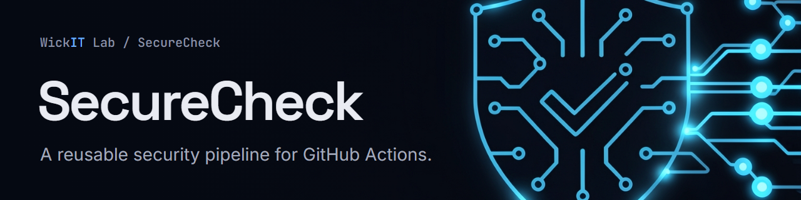

<p align="center">
  
</p>

**One reusable security pipeline for every repository you ship.**

SecureCheck runs a multi-scanner security pipeline on every push and pull request: secrets, SAST, dependency CVEs, IaC and license checks, per-language quality linters and code metrics. Results can be posted to Discord as one severity-coloured embed per run, and an optional Claude review reads the pull request diff for logic issues the scanners miss.

It ships in two forms: a **reusable workflow** (`wickitlab/SecureCheck/.github/workflows/scan.yml@v1`) that manages the whole job for you, and a **composite action** (`wickitlab/SecureCheck@v1`) that adds SARIF upload to GitHub code scanning and a `fail-on` severity gate. Scanners and rules live in this one repository; each consumer repo holds a thin caller, so updates reach every project at once. The glue is Node.js scripts (`scripts/`).

## Contents

- [Tech stack](#tech-stack)
- [Prerequisites](#prerequisites)
- [Getting started](#getting-started)
- [Features (built)](#features-built)
- [Inputs and secrets](#inputs-and-secrets)
- [Usage](#usage)
- [Project structure](#project-structure)
- [Tests](#tests)
- [Security](#security)
- [What's not yet built](#whats-not-yet-built)
- [License](#license)

## Tech stack

| Layer | Technology |
| --- | --- |
| Delivery | GitHub reusable workflow (`.github/workflows/scan.yml`) and composite action (`action.yml`) |
| Secrets | Gitleaks (pinned release) |
| SAST | Semgrep, `auto` ruleset |
| Dependencies, IaC, licenses | Trivy (vulnerabilities, misconfigurations, licenses) |
| Quality linters | ESLint, ruff, `cargo fmt` and clippy, `dotnet format` |
| Metrics | lizard (complexity), jscpd (duplication) |
| Reporting | Node.js scripts: Discord embed, severity gate, optional Claude review (`@anthropic-ai/sdk`) |
| Tests | `node --test` |

## Prerequisites

- A GitHub repository you want to scan, with Actions enabled.
- Optional: a Discord channel with an incoming webhook (channel settings, Integrations, Webhooks, New Webhook, Copy Webhook URL) for the run summary.
- Optional: an Anthropic API key for the Claude pull request review.

## Getting started

1. Create `.github/workflows/security.yml` in the repository you want to scan. Using the reusable workflow:

   ```yaml
   name: Security

   on:
     push:
       branches: [main]
     pull_request:

   permissions:
     contents: read

   jobs:
     scan:
       uses: wickitlab/SecureCheck/.github/workflows/scan.yml@v1
       secrets:
         DISCORD_WEBHOOK_URL: ${{ secrets.DISCORD_WEBHOOK_URL }}      # optional
         ANTHROPIC_API_KEY: ${{ secrets.ANTHROPIC_API_KEY }}          # optional
   ```

   Mapping the two secrets explicitly, rather than `secrets: inherit`, follows least privilege: only these two are ever passed, and both are optional.

2. Optionally set the secrets on the consumer repository (use the secret names, never paste a value into a workflow file):

   ```bash
   gh secret set DISCORD_WEBHOOK_URL --repo <owner>/<repo>
   gh secret set ANTHROPIC_API_KEY --repo <owner>/<repo>
   ```

   The Claude step detects the secret at run time and is skipped silently when it is absent. With no webhook, no Discord message is posted.

3. Or use the composite action instead, if you want SARIF upload to code scanning and the `fail-on` gate:

   ```yaml
   permissions:
     contents: read
     security-events: write   # required to upload SARIF to code scanning

   jobs:
     securecheck:
       runs-on: ubuntu-latest
       steps:
         - uses: actions/checkout@v7
           with:
             fetch-depth: 0     # full history for gitleaks and the PR diff
         - uses: wickitlab/SecureCheck@v1   # pin @v1 for the stable line, @main for latest
           with:
             fail-on: high
             discord-webhook: ${{ secrets.DISCORD_WEBHOOK_URL }}
             anthropic-api-key: ${{ secrets.ANTHROPIC_API_KEY }}
   ```

Copy-paste templates for all of these live in [`examples/`](examples/).

### Versioning

Releases are tagged `vX.Y.Z`: a patch for fixes, a minor for new inputs or behaviour that keeps existing callers working, a major for breaking changes. The `v1` tag moves to the newest `v1.x.y`, so `@v1` picks up fixes without breaking you. Pin an exact tag such as `@v1.0.1`, or a commit SHA, if nothing should change under you. The composite action checks out its own scripts at the same ref you pin, so a pinned caller is reproducible.

## Features (built)

### Scanners

- **Gitleaks**: hardcoded secrets in the working tree and history, on every push and pull request.
- **Semgrep**: pattern-based SAST using the `auto` ruleset.
- **Trivy**: dependency CVEs, IaC and configuration misconfigurations, and license findings, counted separately.

### Quality and metrics

- **Per-language linters, auto-detected**: ESLint (JS/TS, when an ESLint config exists), ruff lint and format check (Python), `cargo fmt --check` and `cargo clippy -D warnings` (Rust), `dotnet format --verify-no-changes` (.NET). Skipped silently when the language is not present.
- **Complexity hotspots**: lizard flags functions with cyclomatic complexity of 15 or more.
- **Duplication detection**: jscpd reports duplicated code blocks across the repository.
- **Performance signals**: each scanner stage is timed; the embed shows the 3 slowest stages.

### Reporting and gating

- **One Discord embed per run** when a webhook is set: severity colouring (green when clean, yellow on findings, orange above 10, red on a Gitleaks hit), per-scanner, per-linter, metrics and performance sections, and links to the workflow run and pull request. It is posted on every run, clean ones included, so reviewers can see the bot executed.
- **Optional Claude review**: on pull requests, Claude Sonnet reviews the diff for logic issues scanners miss; gated on `ANTHROPIC_API_KEY`. The first five critical or high findings appear in the Discord embed with file, line and title.
- **Raw reports kept**: each run uploads per-scanner reports as a workflow artifact with 14-day retention.
- **Composite action only**: SARIF upload of Gitleaks, Semgrep and Trivy findings to GitHub code scanning (Security tab and inline pull request annotations), and a `fail-on` severity gate. Detected secrets always count as critical, and a findings-by-severity table is written to the job summary.
- **Reusable workflow only**: an opt-in `style_check` that fails the run when an em dash is introduced in the change set. It is off by default.

## Inputs and secrets

### Composite action inputs

| Input | Default | Description |
| --- | --- | --- |
| `fail-on` | `none` | Minimum severity that fails the build: `none`, `low`, `medium`, `high`, `critical`. Secrets always count as critical |
| `upload-sarif` | `true` | Upload SARIF to GitHub code scanning (needs `security-events: write`) |
| `run-claude` | `auto` | Optional Claude PR review: `auto` (pull requests with a key), `true` or `false` |
| `node-version` | `20` | Node.js version for JS/TS tooling |
| `python-version` | `3.11` | Python version for Semgrep, ruff and lizard |
| `dotnet-version` | `10.0.x` | .NET SDK version (only used when a .NET project is detected) |
| `gitleaks-version` | `8.24.3` | Pinned Gitleaks release |
| `anthropic-api-key` | empty | Enables the Claude review when set |
| `discord-webhook` | empty | Enables Discord notifications when set |

### Reusable workflow inputs and secrets

| Input | Default | Meaning |
| --- | --- | --- |
| `node_version` | `20` | Node version for ESLint and jscpd |
| `python_version` | `3.11` | Python version for ruff |
| `dotnet_version` | `10.0.x` | .NET SDK for `dotnet format` |
| `style_check` | `false` | Opt-in house-style gate (fails on an introduced em dash) |

| Secret | Required | Used for |
| --- | --- | --- |
| `DISCORD_WEBHOOK_URL` | no | Posting the run summary embed; omit to skip the Discord post |
| `ANTHROPIC_API_KEY` | no | The optional Claude PR review; omit to skip that step |

The reusable workflow uses snake_case input names, while the composite action uses kebab-case. The reusable workflow has no `fail-on` and no SARIF upload; use the composite action for those. Its raw reports are uploaded as `security-reports`; the composite action's are `securecheck-reports`.

## Usage

- **Push to `main`**: the scans run and, when a webhook is set, a single embed is posted with per-scanner counts and a link to the workflow run.
- **Pull request**: the same pipeline runs, the embed is posted whether clean or not, and the optional Claude review runs (pushes skip it to save API calls).
- **Failure gate** (composite action): by default SecureCheck reports without failing (`fail-on: none`). Set `fail-on` to `low`, `medium`, `high` or `critical` to fail the run when a finding meets or exceeds that severity.
- **Code scanning** (composite action): findings appear in the repository's Security tab and as inline annotations on the pull request. Set `upload-sarif: false` to turn it off.
- **Raw reports**: every run uploads the raw JSON from each scanner, useful when you want the full picture without re-running locally.

## Project structure

```
SecureCheck/
  action.yml                    Composite action (SARIF upload, fail-on gate)
  .github/
    workflows/
      scan.yml                  Reusable workflow
      ci.yml                    This repo's own test run (node --test)
      security.yml              This repo scanning itself with the reusable workflow
    dependabot.yml              Keeps action and npm versions current
  scripts/
    embed.mjs                   Pure embed-building logic (counts, colour, fields), unit-tested
    embed.test.mjs              node --test suite for embed.mjs
    notify.mjs                  Entry point: reads env and Claude file, builds the embed, POSTs it
    claude-review.mjs           Sends the PR diff to Claude and emits structured findings
    gate.mjs                    Buckets findings by severity and enforces fail-on
  examples/                     Copy-paste consumer workflows
  assets/                       Banner, logo, social preview and icons
  package.json                  @anthropic-ai/sdk dependency for the optional Claude step
  CHANGELOG.md  ROADMAP.md  SECURITY.md  ARCHITECTURE.md  HOW_IT_WORKS.md
  LICENSE                       AGPL v3
  COMMERCIAL.md                 Commercial license terms
```

## Tests

The embed-building logic (`scripts/embed.mjs`) is pure and unit-tested, with no network and no real workflow run:

```bash
npm test    # node --test over scripts/**/*.test.mjs
```

CI runs the same suite on every push and pull request.

## Security

SecureCheck runs inside other repositories and talks to two optional third-party services (Discord and Anthropic), so its posture is documented in [SECURITY.md](SECURITY.md).

- The reusable workflow requests only `contents: read`. It does not push commits, edit pull requests or post comments.
- `DISCORD_WEBHOOK_URL` is read only by the notify step and never logged. `ANTHROPIC_API_KEY` is read only by the Claude step, which is skipped when the key is empty.
- Gitleaks runs with `--redact`. Semgrep, Trivy and Claude output is not redacted, and anyone who can download artifacts from the consumer repository can read those raw reports.
- The pull request diff sent to Claude is verbatim and capped at 40,000 characters. Do not enable the Claude step on code you treat as confidential without reviewing Anthropic's data policy.
- Third-party actions in `action.yml` and `scan.yml` are pinned to commit SHAs. If this repository were compromised and a consumer pinned `@main`, secrets mapped into the workflow could be exfiltrated; pin a commit SHA if that matters to you.

Report vulnerabilities by email to support@wickitlab.com, not through a public issue.

## What's not yet built

- A consumer smoke fixture (intentional leaks, SAST hits and CVEs) run in this repo's own CI.
- A GitHub Marketplace listing.
- `fail-on` and SARIF upload in the reusable workflow (today only the composite action has them).
- A "fail the PR on critical findings" mode on top of `fail-on`.
- More scanners (osv-scanner, kubesec), Slack or Teams posting alongside Discord, a Markdown PR comment alongside the Discord embed, and a re-run knob to refresh a stale Trivy database.
- The `@anthropic-ai/sdk` dependency is not locked (no committed `package-lock.json`).

## License

This project is dual-licensed:

- [AGPL v3](LICENSE) - free for open-source use. Derivatives and SaaS deployments must release their source under AGPL.
- [Commercial license](COMMERCIAL.md) - for proprietary or closed-source use, or hosted services that do not want to comply with AGPL source-disclosure requirements. Contact support@wickitlab.com for terms.
